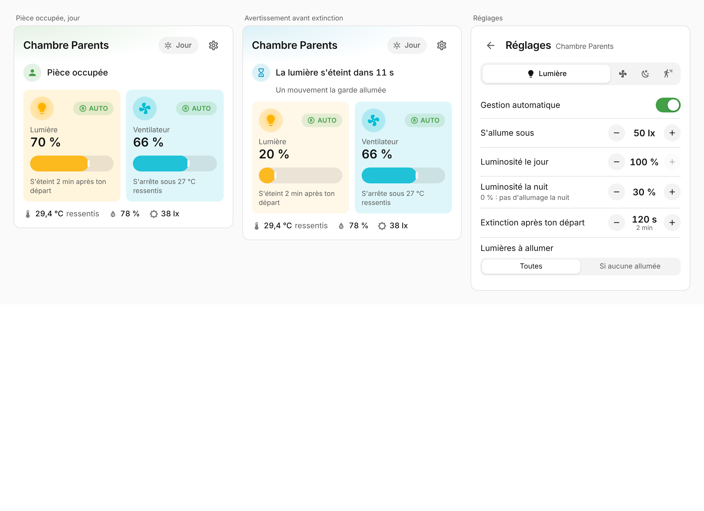
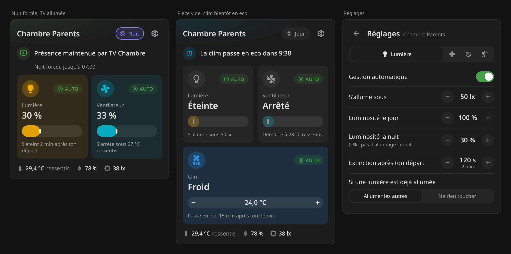

# Lumina Card

Carte Home Assistant pour piloter une pièce gérée par [Lumina](https://github.com/phabrys/lumina) : lumière, ventilateur, clim, mode nuit et tous les réglages, dans une seule carte qui n'affiche que ce qui compte à l'instant présent.




## Ce que montre la carte

La carte s'adapte en permanence à l'état de la pièce :

- **Une phrase « maintenant »** résume la situation, avec la priorité à ce qui demande ton attention : avertissement avant extinction (compte à rebours à la seconde), sommeil (« En sommeil jusqu'à 07:00 », bouton **Réveiller**), contrôle manuel en cours (avec l'heure de reprise, « jusqu'au matin » la nuit, et un bouton **Rendre la main**), confirmation d'absence, échéances en pièce vide (extinctions, clim éteinte ou passée en eco), automatisme en pause (bouton **Réactiver**), présence maintenue par la TV, puis simplement « Pièce occupée » ou « Pièce vide ».
- **Jusqu'à deux notes** complètent la phrase seulement quand c'est utile : détecteur de présence indisponible, nuit forcée jusqu'à telle heure, lumière du jour suffisante, pas d'allumage cette nuit, clim éteinte en ton absence et rétablie à ton retour…
- **Un panneau par groupe** (lumière, ventilateur, clim) avec l'état, un curseur et une indication du prochain comportement : « S'allume sous 50 lx », « S'éteint 2 min après ton départ », « S'arrête sous 27 °C ressentis », « Brassage à 33 % pendant la clim »… L'hélice tourne à la vitesse du ventilateur.
- **La clim** affiche son mode (froid, chauffage, eco…) dans sa couleur, une consigne réglable par − / + et ce que Lumina fera en ton absence : « S'éteint 15 min après ton départ », « Lumina la laisse tourner la nuit », « Lumina ne l'allume jamais »…
- **L'ambiance** : température (ressentie si un capteur d'humidité est configuré, la mesure brute en infobulle), humidité, luminosité.

Une pièce sans ventilateur ni clim n'affiche que la lumière, et les réglages sans objet pour la pièce n'apparaissent pas.

## Gestes

| Geste | Effet |
|---|---|
| Icône d'un panneau | Allume ou éteint (Lumina le compte comme un contrôle manuel) |
| Curseur | Luminosité ou vitesse ; le ventilateur suit ses paliers réels |
| − / + de la clim | Consigne, envoyée une fois que tu arrêtes d'appuyer |
| Pastille **Auto** | Met l'automatisme du groupe en pause : le panneau disparaît tant que Lumina ne le gère plus, et revient dès que l'automatisme est réactivé (bouton **Réactiver** ou réglages) |
| Pastille **Manuel** | Rend la main à Lumina tout de suite |
| Valeur d'un panneau | Ouvre la fiche de l'entité |
| Pastille **Jour / Soirée / Nuit** | Force la nuit (« Nuit maintenant »), ou l'annule |
| Bouton **Sommeil** | Met la pièce en sommeil, ou la réveille (Lumina 0.10) |
| Roue dentée | Réglages de la pièce, par onglets : lumière, ventilateur, clim, nuit, présence |

Dans les réglages, les boutons − / + avancent par pas adaptés à la valeur (5 lx près de 50 lx, 50 lx vers 300 lx, 0,5 °C pour un seuil de température…). La valeur est envoyée une fois que tu arrêtes d'appuyer, et toucher la valeur ouvre la fiche pour une saisie exacte.

Le curseur se manie aussi au clavier (flèches, Origine, Fin), et la carte suit les thèmes clair et sombre de Home Assistant. Elle est en français, avec l'anglais pour les autres langues.

## Prérequis

[Lumina](https://github.com/phabrys/lumina) **0.6.0 ou plus récent** : la carte lit les entités pilotées et les comptes à rebours que Lumina publie depuis cette version, et utilise son bouton « Rendre la main ».

Les fonctions plus récentes apparaissent dès que Lumina les fournit : « Ventilateurs à allumer » avec Lumina 0.7.0, clims, ventilateurs pendant la clim et contrôle manuel jusqu'au matin avec Lumina **0.8.0**. Avec Lumina **0.9.2**, la carte sait quel groupe est en manuel jusqu'au matin et lequel ne l'est que pour la durée réglée. Le sommeil (bouton, phrase, réglages du geste et de la veilleuse) apparaît avec Lumina **0.10.0**. Les fins de nuit des jours de repos et de vacances apparaissent avec Lumina **0.11.0**, quand la pièce a un capteur Workday ou un calendrier de vacances. La soirée (pastille et réglages) apparaît avec Lumina **0.13.0**.

## Installation

### Via HACS (recommandé)

1. HACS → menu ⋮ → **Dépôts personnalisés**.
2. Ajouter `https://github.com/phabrys/lumina-card`, catégorie **Tableau de bord**.
3. Installer **Lumina Card**, puis recharger la page du navigateur.

### Manuelle

Copier `dist/lumina-card.js` dans `config/www/`, puis l'ajouter comme ressource : **Paramètres → Tableaux de bord → ⋮ → Ressources → Ajouter**, URL `/local/lumina-card.js`, type **Module JavaScript**.

## Configuration

Depuis l'éditeur du tableau de bord : **Ajouter une carte → Lumina**, puis choisir la pièce.

En YAML :

```yaml
type: custom:lumina-card
device: 0123456789abcdef0123456789abcdef   # appareil Lumina de la pièce
```

ou, plus lisible, avec n'importe quelle entité Lumina de la pièce :

```yaml
type: custom:lumina-card
entity: sensor.chambre_parents_lumina_chambre_parents_etat_de_la_piece
name: Chambre        # facultatif : nom affiché (par défaut, celui de la pièce)
hide_ambient: false  # facultatif : masque température, humidité et luminosité
```

Options facultatives, aussi réglables depuis l'éditeur :

| Option | Effet |
|---|---|
| `compact: true` | Chaque panneau devient une pastille : icône pour allumer ou éteindre, valeur (et consigne de la clim) qui ouvre la fiche, main pour rendre la main en contrôle manuel. Pas de curseur ni d'indication : pratique pour un tableau de bord qui regroupe toutes les pièces. |
| `hide_panes: [fans, climate]` | Retire des panneaux de la carte (`lights`, `fans`, `climate`). Lumina continue de gérer ces groupes, et la phrase « maintenant » en parle toujours. |
| `hide_settings: true` | Retire la roue dentée, par exemple sur une tablette murale partagée. |

## Développement

Les sources sont en TypeScript, dans `src/`. Il n'y a aucune dépendance à l'exécution : `npm run build` compile avec `tsc` et assemble le tout dans `dist/lumina-card.js`.

```bash
npm install
npm test                       # build + tests du modèle d'affichage
python3 -m http.server 8765    # puis http://localhost:8765/demo/
```

La page `demo/` affiche la carte dans ses principaux états, en thème clair et sombre, avec un faux Home Assistant.

`src/model.ts` décide de ce qui est affiché à un instant donné, sans toucher au DOM : c'est la partie couverte par les tests. `src/card.ts` dessine et transmet les gestes à Home Assistant.

Les versions sont publiées automatiquement : quand la CI réussit sur `main` avec un nouveau numéro de version dans `package.json`, la release GitHub est créée à partir du `CHANGELOG.md`, avec `lumina-card.js` en pièce jointe.

## Licence

MIT. Icônes : [Material Design Icons](https://pictogrammers.com/library/mdi/) (Apache 2.0).
